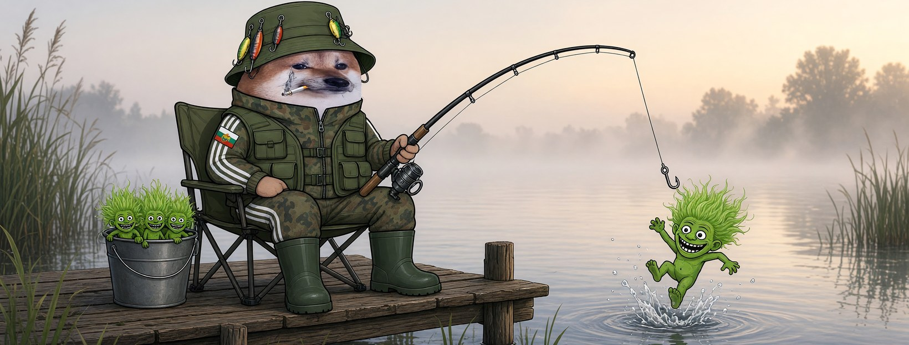

# Елф Рибар




**Свали:** [профилна снимка (avatar.png)](avatar.png) · [корица (cover.jpg)](cover.jpg)

| Поле | Стойност |
|---|---|
| Име на страницата | **Елф Рибар** |
| Потребителско име (предложение) | `@elf.ribar` (или добави град: `@elf.ribar.vidin`) |
| Категория | Digital creator (или Comedian / Satire) |
| Профилна снимка | [avatar.png](avatar.png) (1080×1080) |
| Корица | [cover.jpg](cover.jpg) (1640×624) |

## Био (до 101 знака)

```
Ловя тролове от зори. Те репортват, аз ги вадя от водата. 🎣 Всички сме елфи.
```

## Информация (About)

```
Рибар от Дунава. Търпение, кафе в термос и кофа, пълна с тролове.
Троловете вече не само хапят — и доносничат. Аз не спирам да ловя.

Гражданска страница, вдъхновена от BG Elves. Всички сме елфи.
```

## Първи постове

1. **Представяне** (с корицата)
   ```
   Троловете се оплакаха на модерацията, че ги ловим. 🎣
   Свалиха няколко рибари. Е, сега реката е пълна с нови.
   Аз съм Елф Рибар.
   ```
2. **Ядосан**
   ```
   Една и съща пропагандна копипаста виси с месеци.
   Една шега срещу нея — и страницата е долу за три часа.
   Кой държи въдицата тук, бе?
   ```
3. **Призив**
   ```
   Не захапвайте стръвта, не мълчете и не се плашете от репорти.
   Ако свалят един рибар — на кея сядат десет. Всички сме елфи. 🐟
   ```
