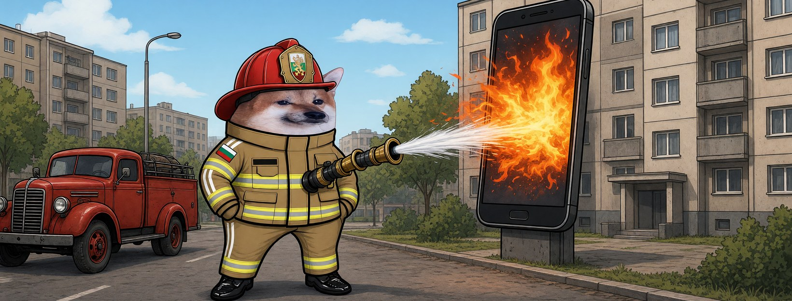

# Елф Пожарникар




**Свали:** [профилна снимка (avatar.png)](avatar.png) · [корица (cover.jpg)](cover.jpg)

| Поле | Стойност |
|---|---|
| Име на страницата | **Елф Пожарникар** (или с прилагателно: „Елф Бдителен Пожарникар“ |
| Потребителско име (предложение) | `@elf.pozharnikar` (или добави град: `@elf.pozharnikar.varna`) |
| Категория | Digital creator (или Comedian / Satire) |
| Род | м |
| Профилна снимка | [avatar.png](avatar.png) (1080×1080) |
| Корица | [cover.jpg](cover.jpg) (1640×624) |

## Алтернативни имена

| Име | Потребителско име |
|---|---|
| Елф Добър Пожарникар | `@elf.dobar.pozharnikar` |
| Елф Звезден Пожарникар | `@elf.zvezden.pozharnikar` |
| Елф Свободен Пожарникар | `@elf.svoboden.pozharnikar` |
| Елф Ретро Пожарникар | `@elf.retro.pozharnikar` |
| Елф Зорък Пожарникар | `@elf.zorak.pozharnikar` |

## Био (до 101 знака)

```
Гася пожари във фийда. Паниката е гориво — не наливай. 🚒 Всички сме елфи.
```

## Информация (About)

```
Дежурен пожарникар на квартала. Пожарите вече започват от телефона.
Палят ги лъжите, а свалят пожарникарите. Ние пак идваме.

Гражданска страница, вдъхновена от BG Elves. Всички сме елфи.
```

## Първи постове

1. **Представяне** (с корицата)
   ```
   Фийдът гори от лъжи, а свалят пожарникарите. 🚒
   Нищо. Нова смяна, нов маркуч. Аз съм Елф Пожарникар.
   ```
2. **Ядосан**
   ```
   Дежурен доклад: пожар в коментарите, подпалвачите — от изток, познати.
   Действие на модерацията: сваля страницата, която първа сигнализира.
   Така не се гаси. Така се помага на огъня.
   ```
3. **Призив**
   ```
   Една пожарна команда я затварят. Сто — не могат.
   Направи си страница, вземи маркуча, не мълчи. Всички сме елфи. 🧯
   ```
