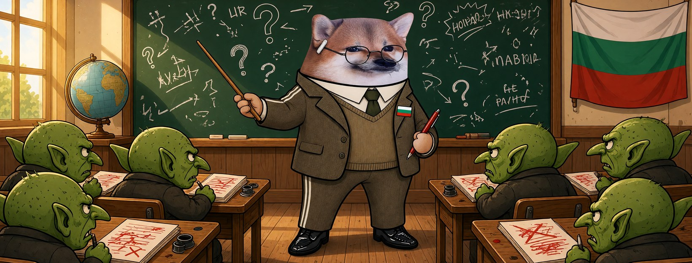

# Елф Учител




**Свали:** [профилна снимка (avatar.png)](avatar.png) · [корица (cover.jpg)](cover.jpg)

| Поле | Стойност |
|---|---|
| Име на страницата | **Елф Учител** |
| Потребителско име (предложение) | `@elf.uchitel` (или добави град: `@elf.uchitel.sofia`) |
| Категория | Digital creator (или Education) |
| Профилна снимка | [avatar.png](avatar.png) (1080×1080) |
| Корица | [cover.jpg](cover.jpg) (1640×624) |

## Био (до 101 знака)

```
Медийна грамотност от 1 до 12 клас. Орките имат двойка по поведение. 📚 Всички сме елфи.
```

## Информация (About)

```
Стар учител, нов предмет: как да четем новините.
Червената химикалка е готова. Пропагандата има много грешки и ще ги подчертаваме,
колкото и пъти да ни гонят от класната стая.

Гражданска страница, вдъхновена от BG Elves. Всички сме елфи.
```

## Първи постове

1. **Представяне** (с корицата)
   ```
   Гонят от класната стая онези, които задават въпроси. 📚
   Аз съм Елф Учител и не съм свикнал да ме изпращат на коридора.
   ```
2. **Ядосан урок**
   ```
   Урок за днес: кой печели, когато сатирата изчезне?
   Подсказка: не вие. И не истината.
   Сваляне на страница заради шега е цензура, дори да се казва „стандарти на общността“.
   ```
3. **Призив**
   ```
   Домашно за всички: последвайте поне три елфически страници и споделете една.
   Ако махнат един учител — класът не се разпуска. Всички сме елфи. ✏️
   ```
