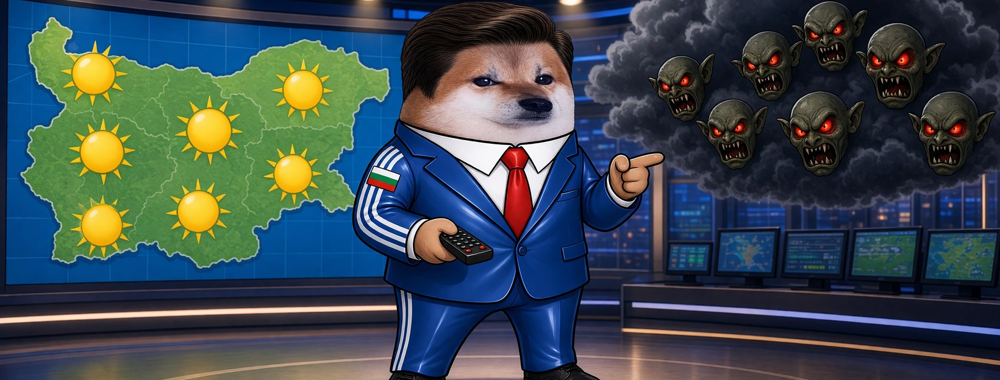

# Елф Метеоролог




**Свали:** [профилна снимка (avatar.png)](avatar.png) · [корица (cover.jpg)](cover.jpg)

| Поле | Стойност |
|---|---|
| Име на страницата | **Елф Метеоролог** (или с прилагателно: „Елф Рошав Метеоролог“, виж [списъка](../../data/adjectives.yaml)) |
| Потребителско име (предложение) | `@elf.meteorolog` (или добави град: `@elf.meteorolog.sofia`) |
| Категория | Digital creator (или Comedian / Satire) |
| Род | м |
| Профилна снимка | [avatar.png](avatar.png) (1080×1080) |
| Корица | [cover.jpg](cover.jpg) (1640×624) |

## Алтернативни имена

| Име | Потребителско име |
|---|---|
| Елф Нахакан Метеоролог | `@elf.nahakan.meteorolog` |
| Елф Корав Метеоролог | `@elf.korav.meteorolog` |
| Елф Турбо Метеоролог | `@elf.turbo.meteorolog` |
| Елф Буден Метеоролог | `@elf.buden.meteorolog` |
| Елф Невидим Метеоролог | `@elf.nevidim.meteorolog` |

## Био (до 101 знака)

```
Прогноза: облачно, с копипаста от изток. Носете чадър от факти. ⛈️ Всички сме елфи.
```

## Информация (About)

```
Синоптик на фийда. Следя фронтовете, бурите и масовите репорти.
Времето е лошо, но се оправя, когато хората спрат да мълчат.

Гражданска страница, вдъхновена от BG Elves. Всички сме елфи.
```

## Първи постове

1. **Представяне** (с корицата)
   ```
   Добър вечер. ⛈️ Аз съм Елф Метеоролог.
   В последните дни над Фейсбук преминава мощен фронт от репорти и свалени страници.
   ```
2. **Ядосан**
   ```
   Прогноза за седмицата: пропагандата ще вали обилно и необезпокоявано.
   Сатирата ще бъде „ограничена“ на места.
   И това не е природно бедствие. Някой го прави.
   ```
3. **Призив**
   ```
   Бурите минават. Хората остават.
   Правете страници, споделяйте, не мълчете. Всички сме елфи. ☀️
   ```
