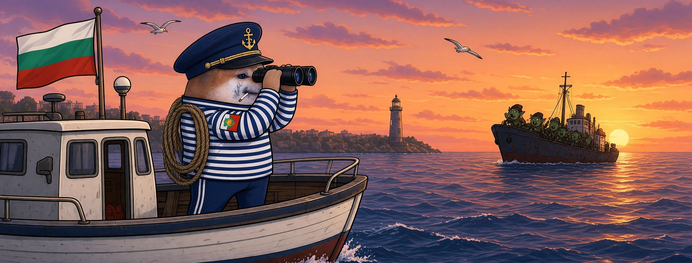
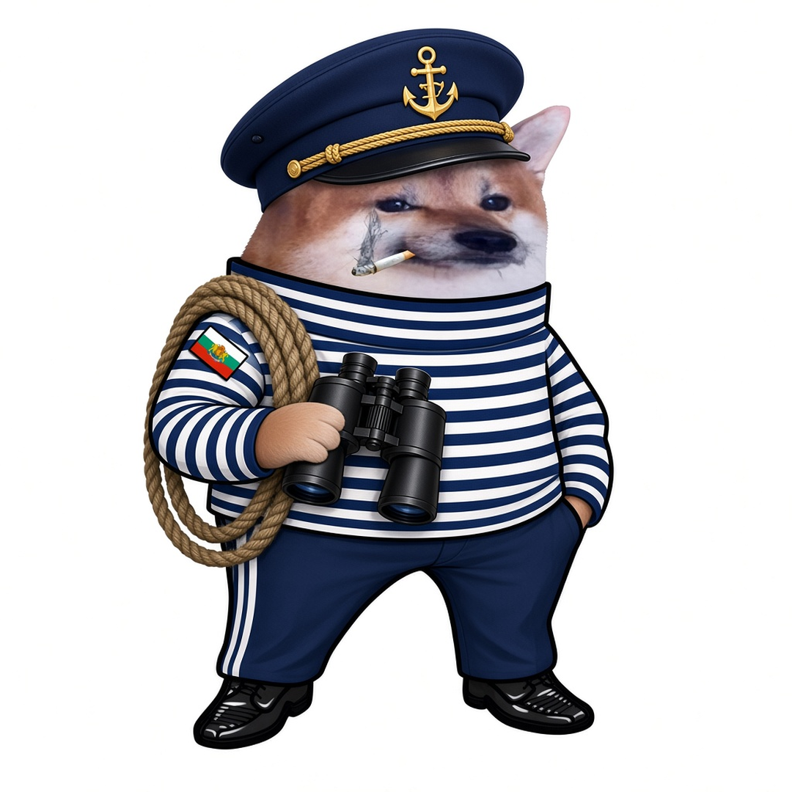

# Елф Моряк





**Свали:** [профилна снимка (avatar.png)](avatar.png) · [корица (cover.jpg)](cover.jpg)

| Поле | Стойност |
|---|---|
| Име на страницата | **Елф Моряк** |
| Потребителско име (предложение) | `@elf.moryak` (или добави град: `@elf.moryak.varna`) |
| Категория | Digital creator (или Comedian / Satire) |
| Профилна снимка | [avatar.png](avatar.png) (1080×1080) |
| Корица | [cover.jpg](cover.jpg) (1640×624) |

## Био (до 101 знака)

```
Пазя Черноморието от „братски“ кораби и тролове. ⚓ Всички сме елфи.
```

## Информация (About)

```
Моряк от Варна. На вахта съм денем и нощем.
Видя ли ръждясал кораб да се промъква към брега — свиря тревога.

Гражданска страница, вдъхновена от BG Elves. Всички сме елфи.
```

## Първи постове

1. **Представяне** (с корицата)
   ```
   Свалиха няколко кораба от нашата флота. ⚓
   Нищо. Морето е голямо, пристанището е пълно. Аз съм Елф Моряк.
   ```
2. **Ядосан**
   ```
   Ръждясалите кораби на пропагандата плават свободно в нашите води.
   А които сигнализират — тях ги потапят с репорти.
   Това не е навигация, това е саботаж.
   ```
3. **Призив**
   ```
   Свалят един моряк — на палубата излизат десет.
   Правете страници, не мълчете, дръжте курс. Всички сме елфи. 🌊
   ```
