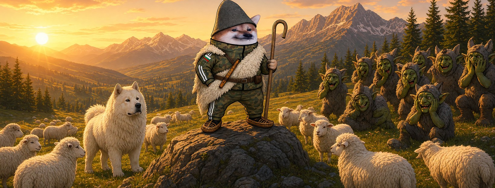

# Елф Овчар




**Свали:** [профилна снимка (avatar.png)](avatar.png) · [корица (cover.jpg)](cover.jpg)

| Поле | Стойност |
|---|---|
| Име на страницата | **Елф Овчар** (или с прилагателно: „Елф Ретро Овчар“ |
| Потребителско име (предложение) | `@elf.ovchar` (или добави град: `@elf.ovchar.rila`) |
| Категория | Digital creator (или Comedian / Satire) |
| Род | м |
| Профилна снимка | [avatar.png](avatar.png) (1080×1080) |
| Корица | [cover.jpg](cover.jpg) (1640×624) |

## Алтернативни имена

| Име | Потребителско име |
|---|---|
| Елф Бодър Овчар | `@elf.bodar.ovchar` |
| Елф Неустрашим Овчар | `@elf.neustrashim.ovchar` |
| Елф Ултра Овчар | `@elf.ultra.ovchar` |
| Елф Вълшебен Овчар | `@elf.valsheben.ovchar` |
| Елф Независим Овчар | `@elf.nezavisim.ovchar` |

## Био (до 101 знака)

```
Пазя стадото от вълци в чужда кожа. И кучето ми е каракачанско. 🐑 Всички сме елфи.
```

## Информация (About)

```
Овчар от Рила. Познавам вълка и когато се облече като овца.
Свиря на кавал, гледам стадото, гледам и фийда.

Гражданска страница, вдъхновена от BG Elves. Всички сме елфи.
```

## Първи постове

1. **Представяне** (с корицата)
   ```
   Чувам, че горе в града свалят страници. 🐑
   Тук в планината вълците ги познаваме по зъбите, не по кожата.
   Аз съм Елф Овчар.
   ```
2. **Ядосан**
   ```
   Вълкът си облича овча кожа и пише „аз съм за мир“.
   Овчарското куче лае — и наказват кучето.
   На това ли му викат модерация?
   ```
3. **Призив**
   ```
   Един овчар сам не може. Цялото село може.
   Правете страници, пазете си стадото, не мълчете. Всички сме елфи. 🐕
   ```
