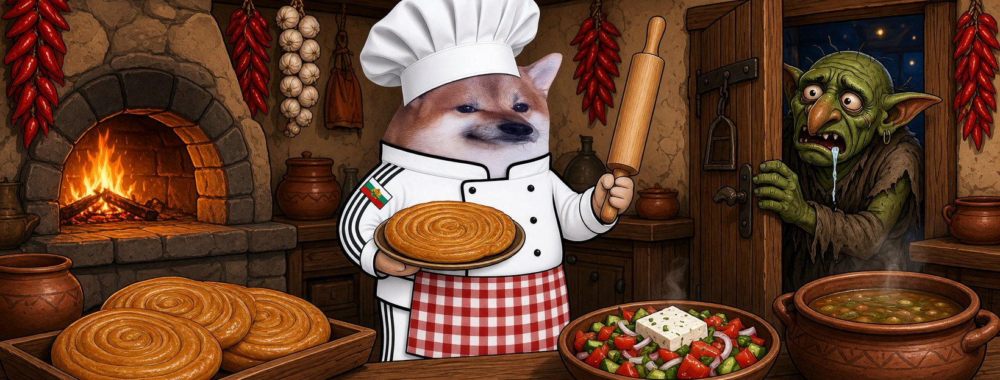
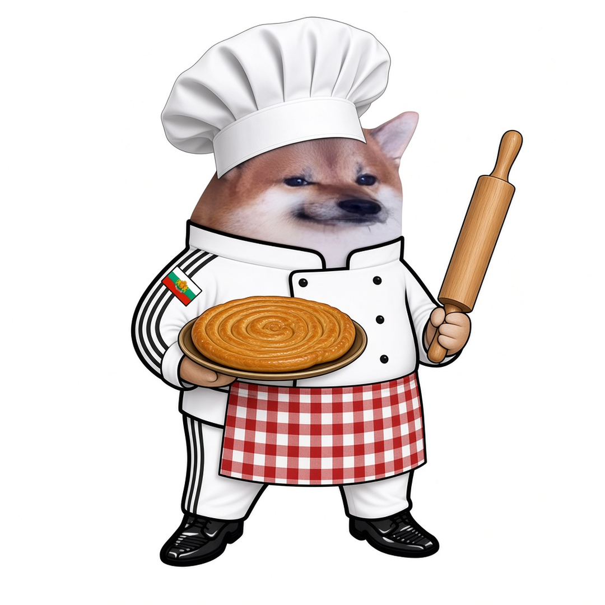

# Елф Готвач





**Свали:** [профилна снимка (avatar.png)](avatar.png) · [корица (cover.jpg)](cover.jpg)

| Поле | Стойност |
|---|---|
| Име на страницата | **Елф Готвач** |
| Потребителско име (предложение) | `@elf.gotvach` (или добави град: `@elf.gotvach.plovdiv`) |
| Категория | Digital creator (или Comedian / Satire) |
| Профилна снимка | [avatar.png](avatar.png) (1080×1080) |
| Корица | [cover.jpg](cover.jpg) (1640×624) |

## Био (до 101 знака)

```
Баница за добрите, точилката за троловете. 🥧 Всички сме елфи.
```

## Информация (About)

```
Готвач в механа. Знам рецептата на всяка лъжа: малко истина, много страх, щипка копипаста.
Тук готвим само с прясно.

Гражданска страница, вдъхновена от BG Elves. Всички сме елфи.
```

## Първи постове

1. **Представяне** (с корицата)
   ```
   Свалят страници заради шеги, а развалената пропаганда стои на витрината. 🥧
   Аз съм Елф Готвач и не сервирам менте.
   ```
2. **Ядосан**
   ```
   Рецепта за пропаганда: вземете стар страх, разбъркайте с лош превод, сервирайте студено в 3 сутринта.
   А който каже „това мирише“ — изхвърлят него от кухнята.
   Не, благодаря.
   ```
3. **Призив**
   ```
   Една кухня я затварят — сто механи отварят.
   Правете страници, не мълчете. Всички сме елфи. 🍲
   ```
