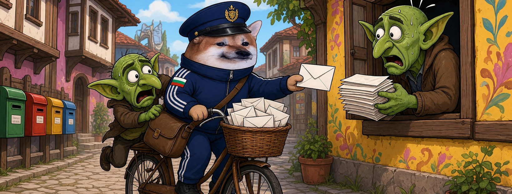

# Елф Пощальон




**Свали:** [профилна снимка (avatar.png)](avatar.png) · [корица (cover.jpg)](cover.jpg)

| Поле | Стойност |
|---|---|
| Име на страницата | **Елф Пощальон** |
| Потребителско име (предложение) | `@elf.poshtalyon` (или добави град: `@elf.poshtalyon.plovdiv`) |
| Категория | Digital creator (или Comedian / Satire) |
| Профилна снимка | [avatar.png](avatar.png) (1080×1080) |
| Корица | [cover.jpg](cover.jpg) (1640×624) |

## Био (до 101 знака)

```
Нося истината до всяка врата. Веригите писма ги хвърлям в коша. ✉️ Всички сме елфи.
```

## Информация (About)

```
Пощальон от Стария Пловдив. Знам всеки адрес и всяка пощенска кутия.
Спамът и веригите „препрати на 10 души“ не минават през мен.

Гражданска страница, вдъхновена от BG Elves. Всички сме елфи.
```

## Първи постове

1. **Представяне** (с корицата)
   ```
   Чувам, че спират разноските на някои страници. ✉️
   Пощата не спира. Аз съм Елф Пощальон.
   ```
2. **Ядосан**
   ```
   Веригите писма „споделете, преди да го изтрият“ стигат до всеки.
   А истинските писма — сатирата — ги връщат с „нарушение“.
   Това не е поща, това е цензура.
   ```
3. **Призив**
   ```
   Свалят една кутия — слагаме десет.
   Правете страници, разнасяйте, не мълчете. Всички сме елфи. 📬
   ```
