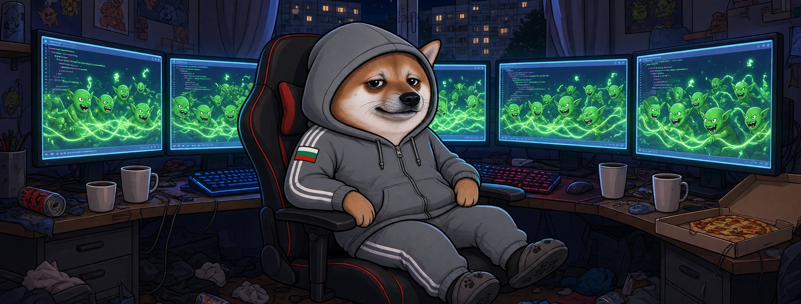

# Елф Програмист




**Свали:** [профилна снимка (avatar.png)](avatar.png) · [корица (cover.jpg)](cover.jpg)

| Поле | Стойност |
|---|---|
| Име на страницата | **Елф Програмист** |
| Потребителско име (предложение) | `@elf.programist` (или добави град: `@elf.programist.sofia`) |
| Категория | Digital creator (или Comedian / Satire) |
| Профилна снимка | [avatar.png](avatar.png) (1080×1080) |
| Корица | [cover.jpg](cover.jpg) (1640×624) |

## Био (до 101 знака)

```
Хващам ботове по-бързо, отколкото пишат копипаста. 💻 Всички сме елфи.
```

## Информация (About)

```
Програмист, кафе, нощ. Познавам бот по три реда коментар.
Кодът ми е отворен, а очите — също.

Гражданска страница, вдъхновена от BG Elves. Всички сме елфи.
```

## Първи постове

1. **Представяне** (с корицата)
   ```
   Свалиха страници, а ботовете си седят. 💻
   Бъг в системата. Аз съм Елф Програмист и докладвам бъга.
   ```
2. **Ядосан**
   ```
   Хиляди профили с по 0 приятели и едно и също мнение — „ок“.
   Една жива страница със смях — „нарушение“.
   Този алгоритъм има нужда от code review.
   ```
3. **Призив**
   ```
   Свалят една инстанция — пускаме десет.
   Правете страници, не мълчете. Всички сме елфи. ⌨️
   ```
