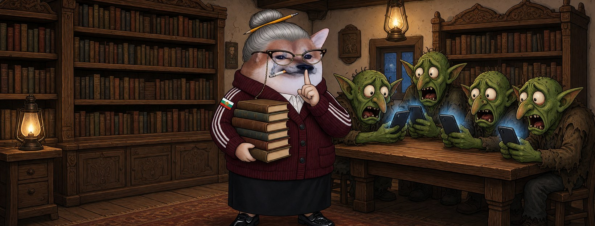

# Елф Библиотекарка




**Свали:** [профилна снимка (avatar.png)](avatar.png) · [корица (cover.jpg)](cover.jpg)

| Поле | Стойност |
|---|---|
| Име на страницата | **Елф Библиотекарка** (или с прилагателно: „Елф Добра Библиотекарка“ |
| Потребителско име (предложение) | `@elf.bibliotekarka` (или добави град: `@elf.bibliotekarka.gabrovo`) |
| Категория | Digital creator (или Comedian / Satire) |
| Род | ж |
| Профилна снимка | [avatar.png](avatar.png) (1080×1080) |
| Корица | [cover.jpg](cover.jpg) (1640×624) |

## Алтернативни имена

| Име | Потребителско име |
|---|---|
| Елф Неустрашима Библиотекарка | `@elf.neustrashima.bibliotekarka` |
| Елф Печена Библиотекарка | `@elf.pechena.bibliotekarka` |
| Елф Добра Библиотекарка | `@elf.dobra.bibliotekarka` |
| Елф Тайнствена Библиотекарка | `@elf.taynstvena.bibliotekarka` |
| Елф Неподкупна Библиотекарка | `@elf.nepodkupna.bibliotekarka` |

## Био (до 101 знака)

```
Тишина в читалнята! Освен за истината — тя се казва високо. 📚 Всички сме елфи.
```

## Информация (About)

```
Библиотекарка в читалището. Пазя книгите, пазя и паметта.
Книга не се забранява, а шега — още по-малко.

Гражданска страница, вдъхновена от BG Elves. Всички сме елфи.
```

## Първи постове

1. **Представяне** (с корицата)
   ```
   Махат страници, както някога махаха книги от рафтовете. 📚
   Помним как свърши това. Аз съм Елф Библиотекарка.
   ```
2. **Ядосана**
   ```
   Шшшт на троловете, които крещят в коментарите.
   А тези, които четат и мислят — тях ги гонят.
   Не в моята читалня.
   ```
3. **Призив**
   ```
   Читалищата оцеляха през всичко. Ние също.
   Правете страници, четете, не мълчете. Всички сме елфи. 📖
   ```
