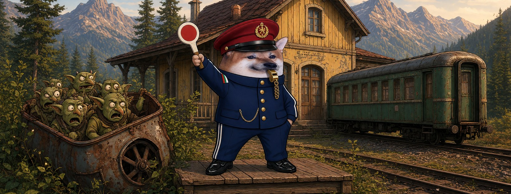

# Елф Железничар




**Свали:** [профилна снимка (avatar.png)](avatar.png) · [корица (cover.jpg)](cover.jpg)

| Поле | Стойност |
|---|---|
| Име на страницата | **Елф Железничар** (или с прилагателно: „Елф Печен Железничар“, виж [списъка](../../data/adjectives.yaml)) |
| Потребителско име (предложение) | `@elf.zheleznichar` (или добави град: `@elf.zheleznichar.gorna-oryahovitsa`) |
| Категория | Digital creator (или Comedian / Satire) |
| Род | м |
| Профилна снимка | [avatar.png](avatar.png) (1080×1080) |
| Корица | [cover.jpg](cover.jpg) (1640×624) |

## Алтернативни имена

| Име | Потребителско име |
|---|---|
| Елф Находчив Железничар | `@elf.nahodchiv.zheleznichar` |
| Елф Кибер Железничар | `@elf.kiber.zheleznichar` |
| Елф Светъл Железничар | `@elf.svetal.zheleznichar` |
| Елф Силен Железничар | `@elf.silen.zheleznichar` |
| Елф Кротък Железничар | `@elf.krotak.zheleznichar` |

## Био (до 101 знака)

```
Пращам пропагандата в задънена линия. 🚂 Всички сме елфи.
```

## Информация (About)

```
Началник гара от Горна Оряховица. Влаковете закъсняват, истината — никога.
Всеки влак знае пътя си. Пропагандата отива на коловоз за скрап.

Гражданска страница, вдъхновена от BG Elves. Всички сме елфи.
```

## Първи постове

1. **Представяне** (с корицата)
   ```
   Спряха няколко влака по линията. 🚂
   Гарата работи. Аз съм Елф Железничар.
   ```
2. **Ядосан**
   ```
   Пропагандата пътува гратис, в първа класа.
   А нашите шеги ги свалят на първата гара без билет.
   Кой ръководи движението тук?
   ```
3. **Призив**
   ```
   Свалят един вагон — закачаме десет.
   Правете страници, не мълчете. Всички сме елфи. 🚉
   ```
