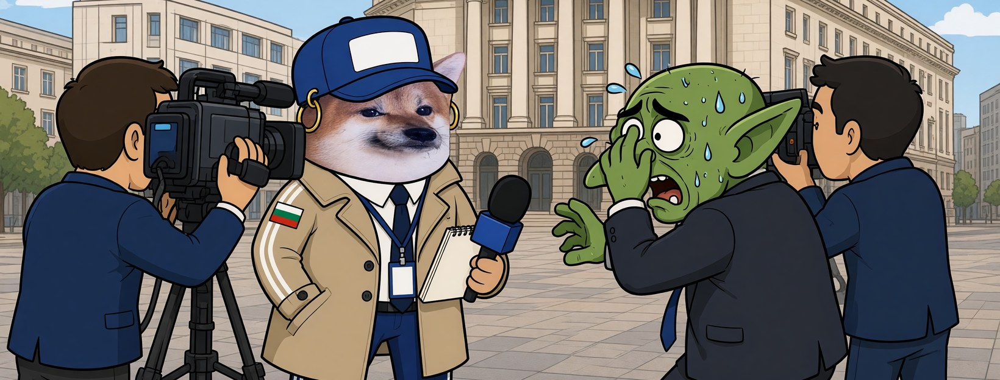

# Елф Журналистка




**Свали:** [профилна снимка (avatar.png)](avatar.png) · [корица (cover.jpg)](cover.jpg)

| Поле | Стойност |
|---|---|
| Име на страницата | **Елф Журналистка** (или с прилагателно: „Елф Твърдоглава Журналистка“, виж [списъка](../../data/adjectives.yaml)) |
| Потребителско име (предложение) | `@elf.zhurnalistka` (или добави град: `@elf.zhurnalistka.sofia`) |
| Категория | Digital creator (или Comedian / Satire) |
| Род | ж |
| Профилна снимка | [avatar.png](avatar.png) (1080×1080) |
| Корица | [cover.jpg](cover.jpg) (1640×624) |

## Алтернативни имена

| Име | Потребителско име |
|---|---|
| Елф Будна Журналистка | `@elf.budna.zhurnalistka` |
| Елф Спокойна Журналистка | `@elf.spokoyna.zhurnalistka` |
| Елф Светла Журналистка | `@elf.svetla.zhurnalistka` |
| Елф Неудържима Журналистка | `@elf.neudarzhima.zhurnalistka` |
| Елф Турбо Журналистка | `@elf.turbo.zhurnalistka` |

## Био (до 101 знака)

```
Задавам въпросите, на които троловете не искат да отговорят. 🎤 Всички сме елфи.
```

## Информация (About)

```
Репортерка от улицата. Микрофонът е готов, камерата — също.
Журналистиката не е престъпление. Сатирата — също.

Гражданска страница, вдъхновена от BG Elves. Всички сме елфи.
```

## Първи постове

1. **Представяне** (с корицата)
   ```
   Свалиха страници. Никой не каза защо. 🎤
   Аз ще питам. Аз съм Елф Журналистка.
   ```
2. **Ядосана**
   ```
   Въпрос към модерацията: защо пропагандата стои, а сатирата пада?
   Отговор: „стандарти на общността“.
   Чия общност, моля?
   ```
3. **Призив**
   ```
   Една уста могат да запушат. Хиляда — не.
   Правете страници, питайте, не мълчете. Всички сме елфи. 📰
   ```
