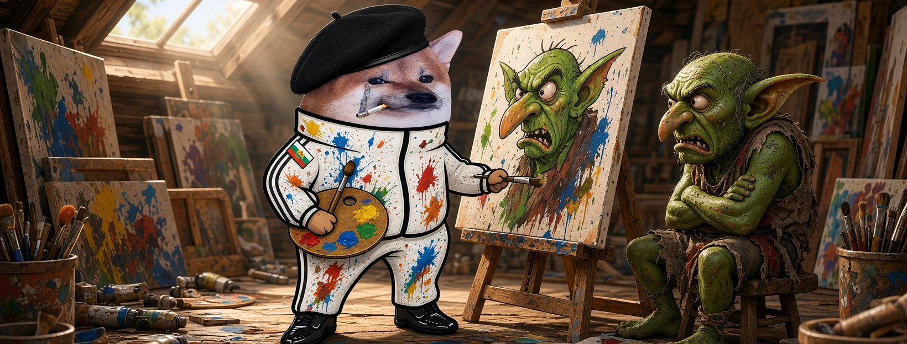

# Елф Художник




**Свали:** [профилна снимка (avatar.png)](avatar.png) · [корица (cover.jpg)](cover.jpg)

| Поле | Стойност |
|---|---|
| Име на страницата | **Елф Художник** |
| Потребителско име (предложение) | `@elf.hudozhnik` (или добави град: `@elf.hudozhnik.veliko-tarnovo`) |
| Категория | Digital creator (или Comedian / Satire) |
| Профилна снимка | [avatar.png](avatar.png) (1080×1080) |
| Корица | [cover.jpg](cover.jpg) (1640×624) |

## Био (до 101 знака)

```
Рисувам троловете такива, каквито са. Те мразят огледалата. 🎨 Всички сме елфи.
```

## Информация (About)

```
Карикатурист от Търново. Една карикатура стига по-далеч от сто анализа.
Затова гонят карикатуристите.

Гражданска страница, вдъхновена от BG Elves. Всички сме елфи.
```

## Първи постове

1. **Представяне** (с корицата)
   ```
   Свалиха страници с карикатури. 🎨
   Четката ми е още в ръка. Аз съм Елф Художник.
   ```
2. **Ядосан**
   ```
   Тролът позира, аз рисувам. Тролът се вижда и се обижда.
   И вместо да се промени — репортва картината.
   Класика.
   ```
3. **Призив**
   ```
   Скъсат ли една рисунка, рисуваме сто.
   Правете страници, рисувайте, не мълчете. Всички сме елфи. 🖌️
   ```
