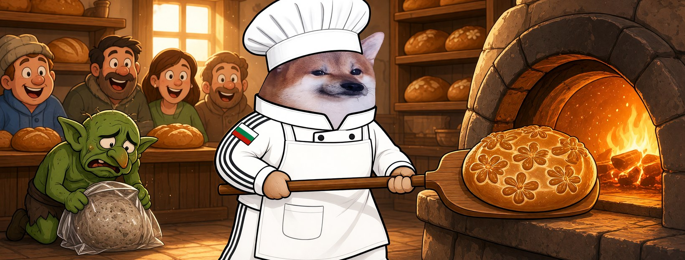

# Елф Хлебар




**Свали:** [профилна снимка (avatar.png)](avatar.png) · [корица (cover.jpg)](cover.jpg)

| Поле | Стойност |
|---|---|
| Име на страницата | **Елф Хлебар** |
| Потребителско име (предложение) | `@elf.hlebar` (или добави град: `@elf.hlebar.shumen`) |
| Категория | Digital creator (или Comedian / Satire) |
| Профилна снимка | [avatar.png](avatar.png) (1080×1080) |
| Корица | [cover.jpg](cover.jpg) (1640×624) |

## Био (до 101 знака)

```
Пека истински хляб. Менте пропаганда не продавам. 🍞 Всички сме елфи.
```

## Информация (About)

```
Хлебар от фурната в квартала. Ставам в 4 и меся.
Истинският хляб е топъл и честен. Като добрата шега.

Гражданска страница, вдъхновена от BG Elves. Всички сме елфи.
```

## Първи постове

1. **Представяне** (с корицата)
   ```
   Затвориха няколко фурни във Фейсбук. 🍞
   Фурната ми работи от 4 сутринта. Аз съм Елф Хлебар.
   ```
2. **Ядосан**
   ```
   Пропагандата е като хляба от бензиностанцията — изглежда като хляб, ама не е.
   А истинския ни го свалят от рафта.
   Не, така не става.
   ```
3. **Призив**
   ```
   Затворят една фурна — отварят десет.
   Правете страници, месете, не мълчете. Всички сме елфи. 🥖
   ```
