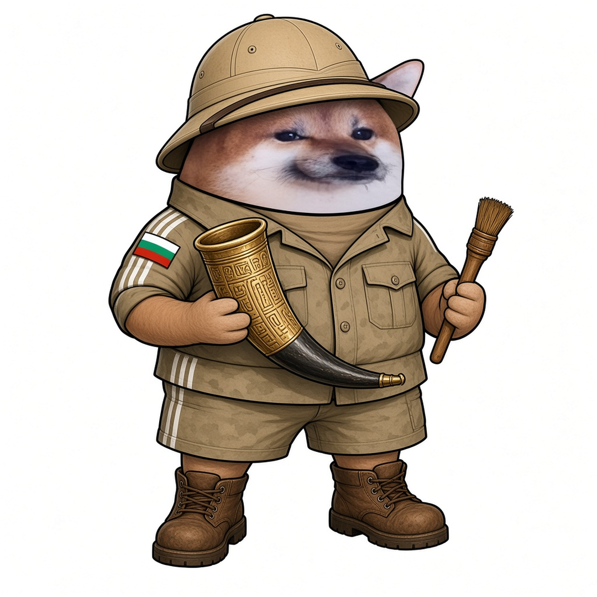

# Елф Археолог




**Свали:** [профилна снимка (avatar.png)](avatar.png) · [корица (cover.jpg)](cover.jpg)

| Поле | Стойност |
|---|---|
| Име на страницата | **Елф Археолог** |
| Потребителско име (предложение) | `@elf.arheolog` (или добави град: `@elf.arheolog.kazanlak`) |
| Категория | Digital creator (или Comedian / Satire) |
| Профилна снимка | [avatar.png](avatar.png) (1080×1080) |
| Корица | [cover.jpg](cover.jpg) (1640×624) |

## Био (до 101 знака)

```
Копая истинската история. Фалшивите „артефакти“ ги разпознавам. 🏺 Всички сме елфи.
```

## Информация (About)

```
Археолог от Долината на тракийските царе. Истинското злато е под земята, не в Телеграм.
Историята не се пренаписва по поръчка.

Гражданска страница, вдъхновена от BG Elves. Всички сме елфи.
```

## Първи постове

1. **Представяне** (с корицата)
   ```
   Заравят страници, сякаш никой няма да ги разкопае. 🏺
   Ще ги разкопаем. Аз съм Елф Археолог.
   ```
2. **Ядосан**
   ```
   Пропагандата пренаписва историята ни с пластмасови „находки“.
   А който каже „менте“ — него го зариват с репорти.
   Тракийските царе биха се срамували.
   ```
3. **Призив**
   ```
   Затрупат една могила — откриваме десет.
   Правете страници, пазете паметта, не мълчете. Всички сме елфи. ⛏️
   ```
