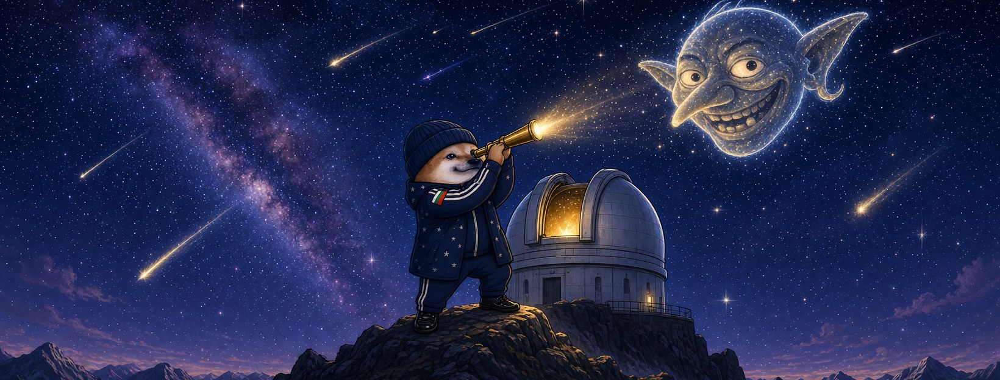

# Елф Астроном




**Свали:** [профилна снимка (avatar.png)](avatar.png) · [корица (cover.jpg)](cover.jpg)

| Поле | Стойност |
|---|---|
| Име на страницата | **Елф Астроном** |
| Потребителско име (предложение) | `@elf.astronom` (или добави град: `@elf.astronom.smolyan`) |
| Категория | Digital creator (или Comedian / Satire) |
| Профилна снимка | [avatar.png](avatar.png) (1080×1080) |
| Корица | [cover.jpg](cover.jpg) (1640×624) |

## Био (до 101 знака)

```
Гледам звездите. Троловете не са звезди, само сателити. 🔭 Всички сме елфи.
```

## Информация (About)

```
Астроном от Рожен. Светлината на звездите идва от много далеч, но е истинска.
Лъжата свети ярко, но угасва бързо.

Гражданска страница, вдъхновена от BG Elves. Всички сме елфи.
```

## Първи постове

1. **Представяне** (с корицата)
   ```
   Угасиха няколко звезди във фийда. 🔭
   Небето е пълно. Аз съм Елф Астроном.
   ```
2. **Ядосан**
   ```
   Пропагандата е черна дупка — дърпа всичко и нищо не излиза.
   А светлите точки — нашите шеги — ги гасят.
   Физиката не работи така.
   ```
3. **Призив**
   ```
   Угасят една звезда — светват сто.
   Правете страници, светете, не мълчете. Всички сме елфи. ✨
   ```
