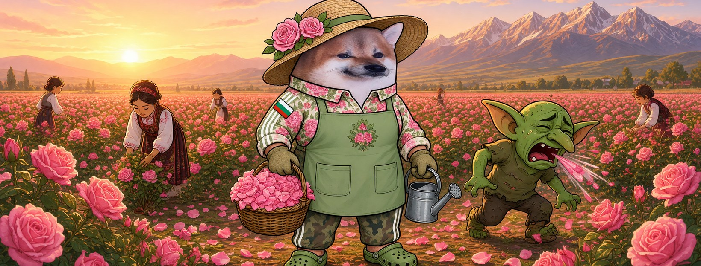

# Елф Розоберачка




**Свали:** [профилна снимка (avatar.png)](avatar.png) · [корица (cover.jpg)](cover.jpg)

| Поле | Стойност |
|---|---|
| Име на страницата | **Елф Розоберачка** (или с прилагателно: „Елф Бодра Розоберачка“ |
| Потребителско име (предложение) | `@elf.rozi` (или добави град: `@elf.rozi.kazanlak`) |
| Категория | Digital creator (или Comedian / Satire) |
| Род | ж |
| Профилна снимка | [avatar.png](avatar.png) (1080×1080) |
| Корица | [cover.jpg](cover.jpg) (1640×624) |

## Алтернативни имена

| Име | Потребителско име |
|---|---|
| Елф Свободна Розоберачка | `@elf.svobodna.rozi` |
| Елф Печена Розоберачка | `@elf.pechena.rozi` |
| Елф Смела Розоберачка | `@elf.smela.rozi` |
| Елф Ултра Розоберачка | `@elf.ultra.rozi` |
| Елф Скромна Розоберачка | `@elf.skromna.rozi` |

## Био (до 101 знака)

```
Розите имат бодли. Троловете кихат от тях. 🌹 Всички сме елфи.
```

## Информация (About)

```
Розоберачка от Розовата долина. Ставам по изгрев, бера по роса.
Розата е нежна, но има бодли. Като нас.

Гражданска страница, вдъхновена от BG Elves. Всички сме елфи.
```

## Първи постове

1. **Представяне** (с корицата)
   ```
   Откъснаха няколко рози от градината. 🌹
   Долината е пълна. Аз съм Елф Розоберачка.
   ```
2. **Ядосана**
   ```
   Троловете тъпчат градината и никой не ги спира.
   А розата, дето им бодне пръста — нея я късат.
   Е, бодлите остават.
   ```
3. **Призив**
   ```
   Откъснат ли една роза, разцъфват хиляда.
   Правете страници, не мълчете. Всички сме елфи. 🌸
   ```
