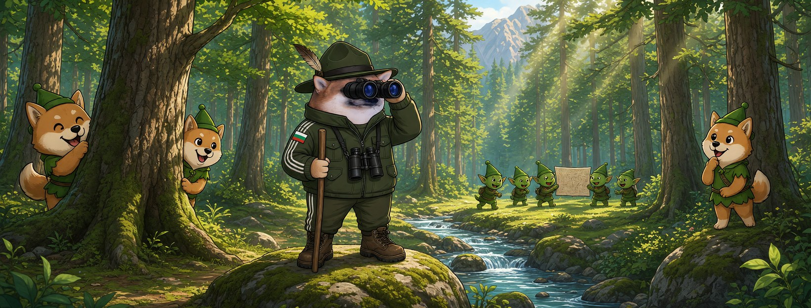

# Елф Горски




**Свали:** [профилна снимка (avatar.png)](avatar.png) · [корица (cover.jpg)](cover.jpg)

| Поле | Стойност |
|---|---|
| Име на страницата | **Елф Горски** (или с прилагателно: „Елф Буден Горски“ |
| Потребителско име (предложение) | `@elf.gorski` (или добави град: `@elf.gorski.teteven`) |
| Категория | Digital creator (или Comedian / Satire) |
| Род | м |
| Профилна снимка | [avatar.png](avatar.png) (1080×1080) |
| Корица | [cover.jpg](cover.jpg) (1640×624) |

## Алтернативни имена

| Име | Потребителско име |
|---|---|
| Елф Среднощен Горски | `@elf.srednoshten.gorski` |
| Елф Честен Горски | `@elf.chesten.gorski` |
| Елф Зорък Горски | `@elf.zorak.gorski` |
| Елф Неустрашим Горски | `@elf.neustrashim.gorski` |
| Елф Сериозен Горски | `@elf.seriozen.gorski` |

## Био (до 101 знака)

```
Пазя гората. Троловете се губят в нея. 🌲 Всички сме елфи.
```

## Информация (About)

```
Горски от Балкана. Тук сме си у дома — ние, елфите.
Гората е голяма, а пътеките ги знаем само ние.

Гражданска страница, вдъхновена от BG Elves. Всички сме елфи.
```

## Първи постове

1. **Представяне** (с корицата)
   ```
   Отсякоха няколко дървета. 🌲
   Гората е голяма. Аз съм Елф Горски.
   ```
2. **Ядосан**
   ```
   Троловете секат незаконно цяла година.
   А който сигнализира — него го пращат от гората.
   Не и в моя участък.
   ```
3. **Призив**
   ```
   Отсекат ли едно дърво, засаждаме сто.
   Правете страници, пазете гората, не мълчете. Всички сме елфи. 🧝
   ```
