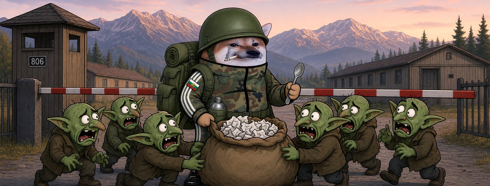

# Елф Редник




**Свали:** [профилна снимка (avatar.png)](avatar.png) · [корица (cover.jpg)](cover.jpg)

| Поле | Стойност |
|---|---|
| Име на страницата | **Елф Редник** (или с прилагателно: „Елф Верен Редник“, виж [списъка](../../data/adjectives.yaml)) |
| Потребителско име (предложение) | `@elf.rednik` (или добави град: `@elf.rednik.pleven`) |
| Категория | Digital creator (или Comedian / Satire) |
| Род | м |
| Профилна снимка | [avatar.png](avatar.png) (1080×1080) |
| Корица | [cover.jpg](cover.jpg) (1640×624) |

## Алтернативни имена

| Име | Потребителско име |
|---|---|
| Елф Неуморим Редник | `@elf.neumorim.rednik` |
| Елф Корав Редник | `@elf.korav.rednik` |
| Елф Вечен Редник | `@elf.vechen.rednik` |
| Елф Ултра Редник | `@elf.ultra.rednik` |
| Елф Хитър Редник | `@elf.hitar.rednik` |

## Био (до 101 знака)

```
Не командвам, но и не мълча. Строй се, рояко! 🪖 Всички сме елфи.
```

## Информация (About)

```
Редник от запаса. Ставам рано, оправям леглото и не вярвам на копипаста.
В казармата научих едно: сам не се оцелява.

Гражданска страница, вдъхновена от BG Elves. Всички сме елфи.
```

## Първи постове

1. **Представяне** (с корицата)
   ```
   Казаха ни „Разотидете се!“ 🪖
   Ние се строихме. Аз съм Елф Редник.
   ```
2. **Ядосан**
   ```
   Троловете имат заповед да пишат по 200 коментара на ден.
   Ние нямаме заповед. Имаме съвест.
   Това им е проблемът.
   ```
3. **Призив**
   ```
   Един редник не е армия. Хиляда редници са.
   Правете страници, застанете в строя, не мълчете. Всички сме елфи. 🧝
   ```
