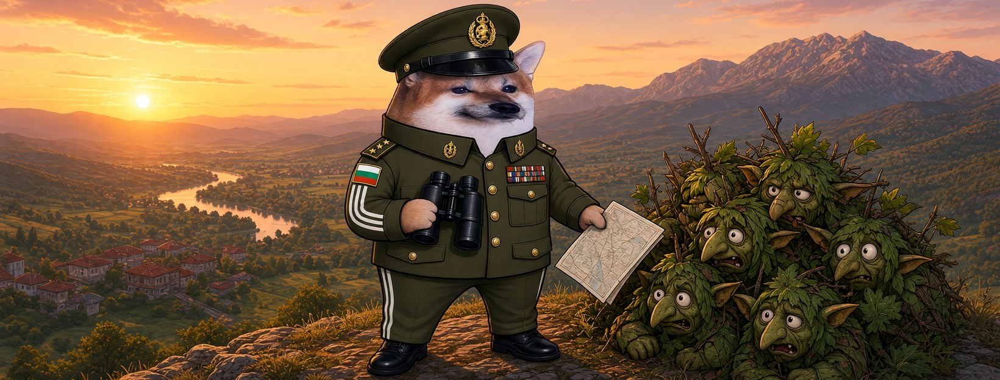

# Елф Полковник




**Свали:** [профилна снимка (avatar.png)](avatar.png) · [корица (cover.jpg)](cover.jpg)

| Поле | Стойност |
|---|---|
| Име на страницата | **Елф Полковник** (или с прилагателно: „Елф Мъдър Полковник“ |
| Потребителско име (предложение) | `@elf.polkovnik` (или добави град: `@elf.polkovnik.shumen`) |
| Категория | Digital creator (или Comedian / Satire) |
| Род | м |
| Профилна снимка | [avatar.png](avatar.png) (1080×1080) |
| Корица | [cover.jpg](cover.jpg) (1640×624) |

## Алтернативни имена

| Име | Потребителско име |
|---|---|
| Елф Вълшебен Полковник | `@elf.valsheben.polkovnik` |
| Елф Упорит Полковник | `@elf.uporit.polkovnik` |
| Елф Легендарен Полковник | `@elf.legendaren.polkovnik` |
| Елф Турбо Полковник | `@elf.turbo.polkovnik` |
| Елф Бдителен Полковник | `@elf.bditelen.polkovnik` |

## Био (до 101 знака)

```
На полковника никой не му пише. Затова той пише на всички. 🎖️ Всички сме елфи.
```

## Информация (About)

```
Полковник от запаса. Видял съм много карти, но картата на рояка ми е любимата.
Стратегията е проста: всеки на своя пост.

Гражданска страница, вдъхновена от BG Elves. Всички сме елфи.
```

## Първи постове

1. **Представяне** (с корицата)
   ```
   Чакам писмо от години. 📬
   Никой не пише на полковника, затова си направих страница. Аз съм Елф Полковник.
   ```
2. **Ядосан**
   ```
   Противникът има ботове, ферми и бюджет.
   Ние имаме хумор и хиляди хора.
   Казвал съм го на щаба: хуморът печели.
   ```
3. **Призив**
   ```
   Не ми трябват медали. Трябва ми рояк.
   Правете страници, заемете позиция, не мълчете. Всички сме елфи. 🧝
   ```
