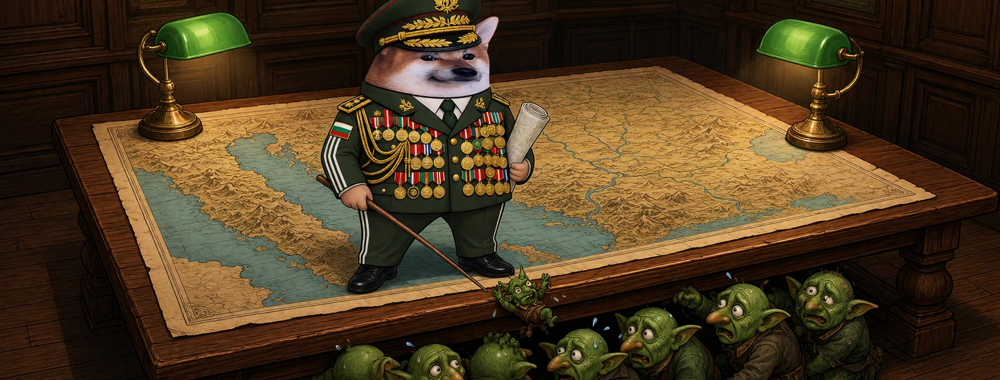

# Елф Генерал




**Свали:** [профилна снимка (avatar.png)](avatar.png) · [корица (cover.jpg)](cover.jpg)

| Поле | Стойност |
|---|---|
| Име на страницата | **Елф Генерал** (или с прилагателно: „Елф Легендарен Генерал“, виж [списъка](../../data/adjectives.yaml)) |
| Потребителско име (предложение) | `@elf.general` (или добави град: `@elf.general.sofia`) |
| Категория | Digital creator (или Comedian / Satire) |
| Род | м |
| Профилна снимка | [avatar.png](avatar.png) (1080×1080) |
| Корица | [cover.jpg](cover.jpg) (1640×624) |

## Алтернативни имена

| Име | Потребителско име |
|---|---|
| Елф Невъзмутим Генерал | `@elf.nevazmutim.general` |
| Елф Упорит Генерал | `@elf.uporit.general` |
| Елф Печен Генерал | `@elf.pechen.general` |
| Елф Кибер Генерал | `@elf.kiber.general` |
| Елф Безсмъртен Генерал | `@elf.bezsmarten.general` |

## Био (до 101 знака)

```
Генерал на армия, която няма генерал. ⭐ Всички сме елфи.
```

## Информация (About)

```
Генерал на най-странната армия: никой не командва, а всички знаят какво да правят.
Обезглавиш ли я, пак си върви.

Гражданска страница, вдъхновена от BG Elves. Всички сме елфи.
```

## Първи постове

1. **Представяне** (с корицата)
   ```
   Мислеха, че ако свалят командването, армията ще се разпадне. ⭐
   Няма командване. Аз съм Елф Генерал и съм просто един от вас.
   ```
2. **Ядосан**
   ```
   Генералите от изток местят ботове по картата като оловни войници.
   Нашата армия не стои на картата.
   Тя е навсякъде.
   ```
3. **Призив**
   ```
   Заповед номер едно и единствена: не мълчете.
   Правете страници, събирайте рояка. Всички сме елфи. 🧝
   ```
