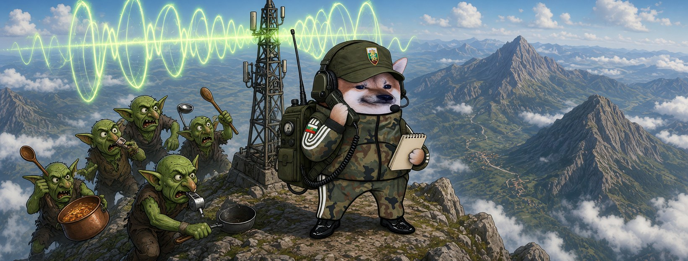

# Елф Свързочник




**Свали:** [профилна снимка (avatar.png)](avatar.png) · [корица (cover.jpg)](cover.jpg)

| Поле | Стойност |
|---|---|
| Име на страницата | **Елф Свързочник** (или с прилагателно: „Елф Неуморим Свързочник“ |
| Потребителско име (предложение) | `@elf.svarzochnik` (или добави град: `@elf.svarzochnik.lovech`) |
| Категория | Digital creator (или Comedian / Satire) |
| Род | м |
| Профилна снимка | [avatar.png](avatar.png) (1080×1080) |
| Корица | [cover.jpg](cover.jpg) (1640×624) |

## Алтернативни имена

| Име | Потребителско име |
|---|---|
| Елф Независим Свързочник | `@elf.nezavisim.svarzochnik` |
| Елф Вълшебен Свързочник | `@elf.valsheben.svarzochnik` |
| Елф Храбър Свързочник | `@elf.hrabar.svarzochnik` |
| Елф Пъргав Свързочник | `@elf.pargav.svarzochnik` |
| Елф Вечен Свързочник | `@elf.vechen.svarzochnik` |

## Био (до 101 знака)

```
Прекъснат ли е сигналът, пускам нов кабел. 📡 Всички сме елфи.
```

## Информация (About)

```
Свързочник. Поддържам връзката между елфите, когато някой я реже.
Кабел, радио, гълъб, все тая. Сигналът минава.

Гражданска страница, вдъхновена от BG Elves. Всички сме елфи.
```

## Първи постове

1. **Представяне** (с корицата)
   ```
   Прекъснаха ни връзката. 📡
   Свързочникът е на линия. Аз съм Елф Свързочник.
   ```
2. **Ядосан**
   ```
   Пропагандата от изток идва с перфектен сигнал, без смущения.
   А нашите шеги ги заглушават.
   Нещо не е наред с антената.
   ```
3. **Призив**
   ```
   Една антена я режат. Мрежа не могат.
   Правете страници, свържете се с другите, не мълчете. Всички сме елфи. 🧝
   ```
