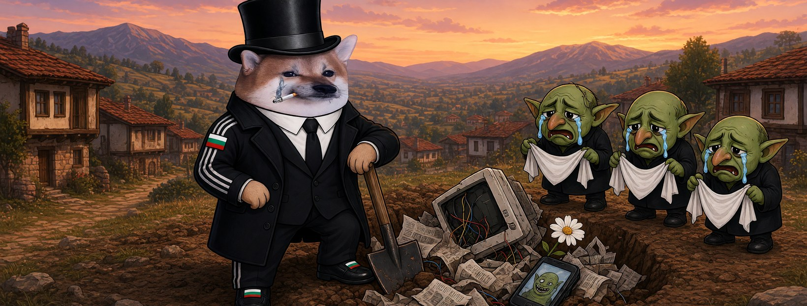

# Елф Гробар




**Свали:** [профилна снимка (avatar.png)](avatar.png) · [корица (cover.jpg)](cover.jpg)

| Поле | Стойност |
|---|---|
| Име на страницата | **Елф Гробар** (или с прилагателно: „Елф Спокоен Гробар“ |
| Потребителско име (предложение) | `@elf.grobar` (или добави град: `@elf.grobar.burgas`) |
| Категория | Digital creator (или Comedian / Satire) |
| Род | м |
| Профилна снимка | [avatar.png](avatar.png) (1080×1080) |
| Корица | [cover.jpg](cover.jpg) (1640×624) |

## Алтернативни имена

| Име | Потребителско име |
|---|---|
| Елф Сериозен Гробар | `@elf.seriozen.grobar` |
| Елф Кибер Гробар | `@elf.kiber.grobar` |
| Елф Мъдър Гробар | `@elf.madar.grobar` |
| Елф Силен Гробар | `@elf.silen.grobar` |
| Елф Огнен Гробар | `@elf.ognen.grobar` |

## Био (до 101 знака)

```
Всяка лъжа стига до мен накрая. Копая без бързане. ⚰️ Всички сме елфи.
```

## Информация (About)

```
Гробар в селото от 30 години. Спокоен, точен, с лопата и цигара.
Виждал съм да погребват велики империи и още повече велики лъжи. Всички стигат до мен.

Гражданска страница, вдъхновена от BG Elves. Всички сме елфи.
```

## Първи постове

1. **Представяне** (с корицата)
   ```
   Някой побърза да ни погребе. ⚰️
   Проверих: дупката е празна. Аз съм Елф Гробар.
   ```
2. **Ядосан**
   ```
   Тролът пише, че Европа умира.
   Пише го от двайсет години.
   Аз съм гробар. Европа не е при мен. Фейковете са.
   ```
3. **Призив**
   ```
   Свалената страница не е погребана, ако на мястото ѝ се появят десет нови.
   Правете страници, не се плашете, не мълчете. Всички сме елфи. 🧝
   ```
